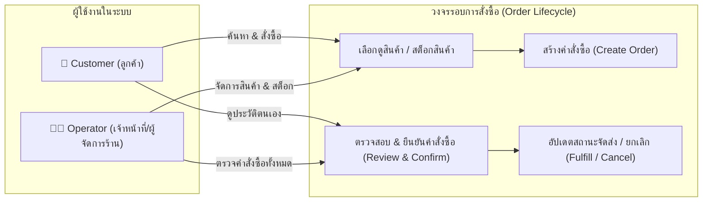
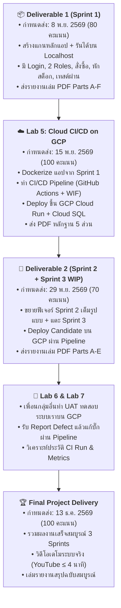

# 🛒 CPE 334 Project Context: E-Commerce / Ordering System (ระบบสั่งซื้อสินค้า)

> **Course:** CPE 334 Introduction to Software Engineering in the Age of AI Agents (Semester 1/2026, KMUTT)  
> **Team Size:** 2 Students (Pair Work)  
> **Theme:** E-Commerce or Ordering System (ระบบสั่งซื้อสินค้า)  
> **Assigned User Roles:** `Customer` (ลูกค้า) และ `Operator` (เจ้าหน้าที่จัดการคำสั่งซื้อ/แอดมินร้านค้า)  
> **Root Directory:** `mini project`

---

## 1. Project Purpose & Overview (เกี่ยวกับโปรเจกต์)

โปรเจกต์นี้เป็นการพัฒนาระบบสั่งซื้อสินค้าออนไลน์ (E-Commerce / Ordering System) แบบ Full-Stack พร้อมทั้งปฏิบัติตามมาตรฐานวิศวกรรมซอฟต์แวร์สมัยใหม่ในยุค AI Agents ตั้งแต่:
1. การวิเคราะห์ความต้องการและการทำสัญญาทางวิศวกรรม (SRS, Traceability, System-Level SDS, Engineering Contracts)
2. การพัฒนาซอฟต์แวร์ด้วย Test-Driven Development (TDD) และ Automated Testing ครบทุกระดับ (Unit, Integration, E2E)
3. การทำงานเป็นคู่ (Pair Collaboration) ผ่าน Git Workflow, Pull Requests และ Peer Review
4. การสร้างระบบส่งมอบซอฟต์แวร์อัตโนมัติ (Automated CI/CD Pipeline) บน GitHub Actions
5. การ Deploy ระบบขึ้น Google Cloud Platform (Cloud Run + Cloud SQL PostgreSQL) ภายใต้แนวคิด Security-first (No leaked secrets, WIF) และ Cost Control

---

## 2. Actors & Core Roles (บทบาทผู้ใช้งานในระบบ)

ระบบนี้มี 2 บทบาทหลักตามโจทย์ที่ได้รับ:

| บทบาท (Role) | ความรับผิดชอบหลัก & ขอบเขตการทำงาน | สิทธิ์ในการเข้าถึง (Access Control) |
|---|---|---|
| **Customer** (ลูกค้า) | - สมัคร/เข้าสู่ระบบ และดูข้อมูลส่วนตัวตนเอง - ดูรายการสินค้า ราคาสินค้า และจำนวนสต็อกคงเหลือ - สร้างคำสั่งซื้อใหม่ (เลือกสินค้า, คำนวณยอดเงินรวม) - ดูประวัติคำสั่งซื้อและสถานะของตัวเอง - ยกเลิกคำสั่งซื้อของตนเองได้ (เฉพาะสถานะที่อนุญาต เช่น `PENDING`) | - ดู/แก้ได้**เฉพาะคำสั่งซื้อของตนเองเท่านั้น** (Owner Isolation) - **ไม่มีสิทธิ์**ดูคำสั่งซื้อของลูกค้าคนอื่น - **ไม่มีสิทธิ์**เปลี่ยนสถานะคำสั่งซื้อเป็น `CONFIRMED` หรือ `SHIPPED` |
| **Operator** (เจ้าหน้าที่) | - เข้าสู่ระบบเพื่อเข้าแดชบอร์ดจัดการร้านค้า - ดูรายการคำสั่งซื้อทั้งหมดในระบบ - อนุมัติ / ปรับเปลี่ยนสถานะคำสั่งซื้อ (`PENDING` $\rightarrow$ `CONFIRMED` $\rightarrow$ `PROCESSING` $\rightarrow$ `SHIPPED` / `CANCELLED`) - ตรวจสอบและจัดการสต็อกสินค้า | - เข้าถึงคำสั่งซื้อของลูกค้าทุกคนได้ - จัดการสถานะคำสั่งซื้อและสต็อกสินค้าได้ - **ห้าม**สร้างคำสั่งซื้อในฐานะลูกค้าทั่วไปผ่านหน้า Operator (Role Separation) |

---

## 3. Semester Roadmap & Deliverables (ไทม์ไลน์ภาพรวมทั้งเทอม)

โปรเจกต์นี้มีงานต่อเนื่องกันตลอดเทอม โดยใช้ Repository และโค้ดชุดเดียวกัน:

---

## 4. Engineering Standards & Workflows (ข้อตกลงและกระบวนการทำงาน)

### 4.1 Git Branching & Quality Gate
- **`main`**: กิ่งที่พร้อม Deploy และเป็น Production (ถูกล็อกด้วย Ruleset: ห้าม push ตรง, ต้องมี 1 Approval จากเพื่อน, และ CI ต้องเขียว)
- **`staging`**: กิ่งสำหรับรวมโค้ดที่ผ่านการทดสอบใน Sprint
- **Feature/Fix Branch**: แตกจาก `staging` เช่น `feat/auth-system`, `feat/order-creation`

### 4.2 Pair Collaboration Protocol (การแบ่งงานกับเพื่อน 2 คน)
ตามข้อกำหนด **R-09** และ **R-11**:
1. **Author-Reviewer Alternation:** สลับกันเป็นคนเขียนโค้ด (Author) และคนตรวจ (Reviewer) ในทุก ๆ Feature
2. **No Self-Approve:** ผู้เปิด PR ห้ามกด Approve PR ของตนเอง
3. **Substantive Review:** การรีวิวต้องมีสาระจริง (ตรวจสอบความปลอดภัย, ตรรกะทางธุรกิจ, ผลเทสต์)
4. **Issue-Driven Development:** ทุกงานต้องเริ่มจาก Issue บน GitHub Project Board และปิดด้วยหลักฐาน PR/Screenshot

### 4.3 Test-Driven Development (TDD) & Contract First
- เขียน **Engineering Contract (AC, STS)** ก่อนลงมือเขียนโค้ดเสมอ
- ต้องมีหลักฐานการรันเทสต์แบบ **Red $\rightarrow$ Green** (เทสต์ต้องเฟลก่อนเมื่อยังไม่เขียนโค้ด แล้วจึงผ่านเมื่อโค้ดเสร็จ)
- มีการทดสอบครอบคลุม:
  - **Domain Rules:** ห้ามสั่งของจำนวนเป็นลบ, สต็อกไม่พอต้อง Reject
  - **Access Control:** Unauthenticated request ต้องโดน 401, ข้ามสิทธิ์ต้องโดน 403

### 4.4 Cloud Architecture & Security Contract (สำหรับ Lab 5 และอนาคต)
- **Compute:** Google Cloud Run (Container, Port `$PORT`, Scale to 0)
- **Database:** Google Cloud SQL (PostgreSQL 16) เก็บข้อมูลถาวร
- **Secrets:** Google Secret Manager (ห้าม commit `.env` หรือ Key จริงเด็ดขาด)
- **Authentication to GCP:** Workload Identity Federation (WIF) ปราศจาก JSON Key
- **Cost Control:** ตั้ง Budget Alert เสมอ, ปิด Storage Auto-Increase, Pause DB เมื่อไม่ใช้งาน

---

## 5. Next Steps (ขั้นตอนถัดไป)

1. **หารือโครงสร้างระบบ Sprint 1 อย่างละเอียด** (ขอบเขตฟังก์ชันของ Customer และ Operator)
2. **สร้าง Skills ประจำโปรเจกต์** เพื่อเป็นเครื่องมือผู้ช่วย AI ในการสร้างเอกสารและควบคุมมาตรฐานโค้ด:
   - Skill สำหรับสร้าง Engineering Contracts (Part A-E)
   - Skill สำหรับควบคุม Git/PR Workflow และการบันทึกหลักฐาน
   - Skill สำหรับ Automated Testing & Docker/GCP Deployment
