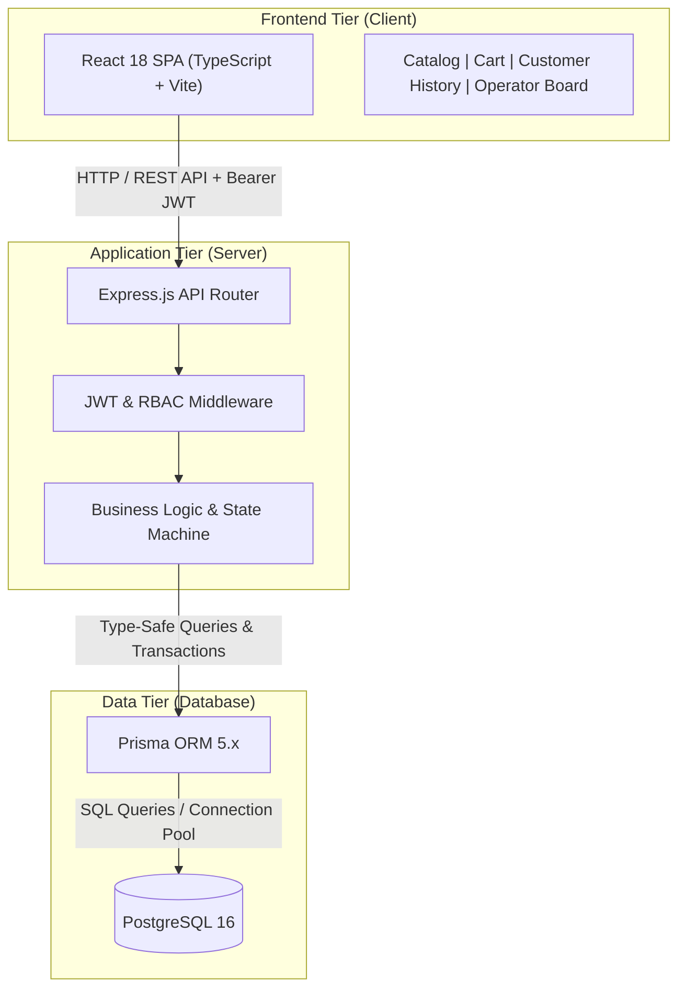

# CPE 334 E-Commerce Ordering System

> **Course:** CPE 334 Introduction to Software Engineering in the Age of AI Agents (Semester 1/2026, KMUTT)  
> **Team Members:**
> - Jiraphat Jarernpipattada (`@jiraphat-j`)
> - Thanaporn Boont (`@thanapornboont-star`)
> **Project Topic:** E-Commerce / Ordering System  
> **Repository:** https://github.com/jiraphat-j/cpe334-ecommerce  

---

## 1. Project Overview

This project is a modern, full-stack E-Commerce Ordering System engineered under disciplined software engineering practices for the AI era. It features strict role separation between **Customer** and **Operator**, atomic transaction-backed order fulfillment, and automated continuous integration.

### Core Roles & Capabilities
* **Customer:**
  * Register account with secure salted password hashing (bcrypt).
  * Authenticate and receive signed JSON Web Tokens (JWT).
  * Browse the public product catalog with real-time stock availability.
  * Place multi-item orders with atomic stock validation and decrements (`prisma.$transaction`).
  * View isolated personal order history (protected against Insecure Direct Object References - IDOR).
* **Operator:**
  * Access store-wide order fulfillment management board.
  * Inspect all orders, customer identities, item breakdowns, and statuses.
  * Transition order states following strict state machine rules (`PENDING` -> `CONFIRMED` or `CANCELLED`).
  * Enforced Role-Based Access Control (RBAC) rejecting non-operators with HTTP 403 Forbidden.

---

## 2. Technology Stack & Architecture



* **Frontend:** React 18, TypeScript, Vite, CSS Grid/Flexbox
* **Backend:** Node.js 24, Express.js, TypeScript, JWT (`jsonwebtoken`), Bcrypt (`bcryptjs`)
* **Database & ORM:** PostgreSQL 16, Prisma ORM
* **Testing:** Vitest, Supertest
* **CI/CD & DevOps:** GitHub Actions, Docker (multi-stage production build), Google Cloud Platform (Cloud Run & Cloud SQL)

---

## 3. Sprint 1 Deliverables & Contracts Summary

Sprint 1 delivers the full functional baseline and engineering documentation (Deliverable 1, due 8 Nov 2026):

* **Documentation Baseline:**
  * `docs/srs.md`: Software Requirements Specification (FR-01..07, BR-01..06, NFR-01..04)
  * `docs/traceability.md`: Traceability Matrix mapping business rules to automated test IDs
  * `docs/system-sds.md`: 3-Tier Architecture, ER Model, Database Schema, and RBAC matrix
  * `docs/sprints/plan.md`: 3-Sprint Roadmap, User Stories, and Estimation Points
  * `docs/sprints/sprint-1/contracts.md`: Sprint 1 Acceptance Criteria (AC-01..10) and STS (TEST-01..16)
* **Automated Verification:**
  * 22 backend automated integration/unit tests across 3 suites.
  * 1 frontend integration test suite and strict TypeScript build validation.

---

## 4. API Specification

| Method | Endpoint | Access Role | Description |
|---|---|:---:|---|
| `POST` | `/api/auth/register` | Public | Register new customer account |
| `POST` | `/api/auth/login` | Public | Authenticate user and receive JWT |
| `GET` | `/api/auth/me` | Authenticated | Retrieve current user profile |
| `GET` | `/api/products` | Public | List products and available inventory |
| `POST` | `/api/orders` | Customer | Place order with atomic stock decrement |
| `GET` | `/api/orders/my-orders` | Customer | Retrieve customer's own order history |
| `GET` | `/api/operator/orders` | Operator | Retrieve all store orders across all users |
| `PATCH` | `/api/operator/orders/:id/status` | Operator | Update order status (PENDING -> CONFIRMED/CANCELLED) |

---

## 5. Getting Started (Local Development)

### Prerequisites
* Node.js 24 LTS or higher
* npm 10+
* Docker & Docker Compose (or local PostgreSQL 16 instance)

### Installation & Database Setup

1. **Clone repository:**
   ```bash
   git clone https://github.com/jiraphat-j/cpe334-ecommerce.git
   cd cpe334-ecommerce
   ```

2. **Backend Setup:**
   ```bash
   cd server
   cp .env.example .env
   npm install
   npx prisma migrate deploy
   npm run prisma:seed
   npm run dev
   ```
   Server will listen on `http://localhost:3000`.

3. **Frontend Setup:**
   ```bash
   cd ../client
   npm install
   npm run dev
   ```
   Client SPA will run on `http://localhost:5173`.

### Demo Credentials (Created by Seed)
* **Operator:** `operator@store.com` / `OperatorPass123!`
* **Customer:** `alice@customer.com` / `CustomerPass123!`
* **Customer 2:** `bob@customer.com` / `CustomerPass123!`

---

## 6. Automated Testing

### Backend Test Suite (Vitest + Supertest)
```bash
cd server
npm test
```
Executes all 22 test specifications covering:
* `tests/auth.test.ts`: Password hashing, token validation, 401 unauthenticated guard
* `tests/order.test.ts`: Atomic stock deduction, insufficient stock rejection, anti-IDOR isolation
* `tests/operator.test.ts`: Operator order retrieval, status state machine invariants, 403 role block

### Frontend Tests & Production Build
```bash
cd client
npm test
npm run build
```

---

## 7. Continuous Integration & Branching Strategy

* **`main`:** Production-ready code, protected by branch ruleset.
* **`staging-sprint-1`:** Active sprint integration branch.
* **Feature Branches:** `feat/<issue-name>` branched from `staging-sprint-1`.
* **CI Workflow (`.github/workflows/ci-docker.yml`):**
  * Spawns PostgreSQL service container in GitHub Actions runner.
  * Runs database migrations and seeds baseline data.
  * Executes backend test suites, frontend tests, and production build.
  * Verifies multi-stage unified Dockerfile build (`test-and-docker` check).
