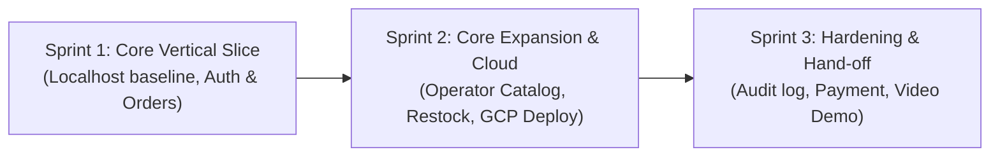

# Three-Sprint Product Roadmap Plan

> **Document ID:** SPRINT-PLAN-01  
> **Milestone:** Deliverable 1 (Part D)  
> **Course:** CPE 334 Introduction to Software Engineering in the Age of AI Agents  
> **Theme:** E-Commerce or Ordering System (Customer / Operator)

---

## 1. Overview and Engineering Progression

The product lifecycle spans three sequential sprints, establishing progressive capabilities from a robust local core to an integrated, cloud-deployed product:

---

## 2. Sprint Details

### Sprint 1: Engineering Baseline & Core Vertical Slice
- **Checkpoint:** Deliverable 1 (Due 8 Nov 2026, 23:59) - 80 points
- **Primary Goal:** Prove engineering foundation, complete domain journey on Localhost with database persistence, role segregation, business rule validation, and automated tests.
- **Included Features:**
  - `F-01`: User Auth & Role RBAC (`Customer` and `Operator`)
  - `F-02`: Product Catalog & Stock Availability
  - `F-03`: Customer Order Placement with Atomic Stock Decrement
  - `F-04`: Operator Order Management & Status Transitions
- **Dependencies:** None (Baseline implementation).
- **Completion Outcome:**
  - Full domain transaction running locally: Customer registers $\rightarrow$ places order $\rightarrow$ stock decrements $\rightarrow$ Operator logs in $\rightarrow$ confirms order.
  - Automated test suite verifying business rules (`BR-01` to `BR-06`) and access controls (`NFR-01`).
  - GitHub peer review workflow: Feature branch $\rightarrow$ PR to `staging-sprint-1` with review $\rightarrow$ merge to `main`.
  - Comprehensive Deliverable 1 PDF report covering Parts A–F.

---

### Sprint 2: Core Expansion & Cloud Deployment
- **Checkpoint:** Deliverable 2 (Due 29 Nov 2026, 23:59) - 70 points
- **Primary Goal:** Expand domain functionality and maintain a continuous delivery candidate deployed on Google Cloud Platform.
- **Included Features:**
  - `F-05`: Product Catalog Management (Operator can add, edit, and adjust product stock)
  - `F-06`: Multi-Item Shopping Cart (multiple line items per order)
  - `F-07`: Customer Order Self-Cancellation with automated stock restoration
- **Dependencies:** Completed Sprint 1 baseline and Lab 5 deployment pipeline.
- **Completion Outcome:**
  - Core expansion features verified against formal engineering contracts.
  - Release candidate running on Google Cloud Run with persistent Cloud SQL.
  - Full traceability matrix updated with Sprint 2 execution results.

---

### Sprint 3: Advanced Hardening, Integration & Final Release
- **Checkpoint:** Final Project Delivery (Due 13 Dec 2026, 23:59) - 100 points
- **Primary Goal:** Integrate full three-sprint scope, resolve partner team defects from Lab 6 UAT, and provide engineering hand-off with demonstration video.
- **Included Features:**
  - `F-08`: Order Tracking Timeline & Operator Audit Trail
  - `F-09`: Simulated Payment Gateway Integration & Webhook Handler
  - Product Hardening: Full regression test suite, rate limiting, and defect resolution.
- **Dependencies:** Sprint 1 and Sprint 2 increments, Lab 6 UAT defect reports.
- **Completion Outcome:**
  - 100% of agreed baseline features active and verified on GCP.
  - Defect and technical debt register showing resolution of all critical items.
  - 4-minute demonstration video explaining architecture, domain workflow, and failure recovery.
  - Final comprehensive engineering PDF report.
