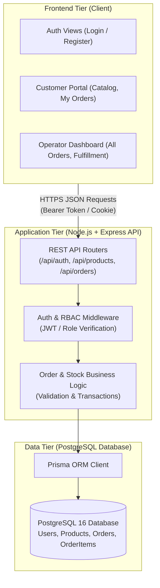
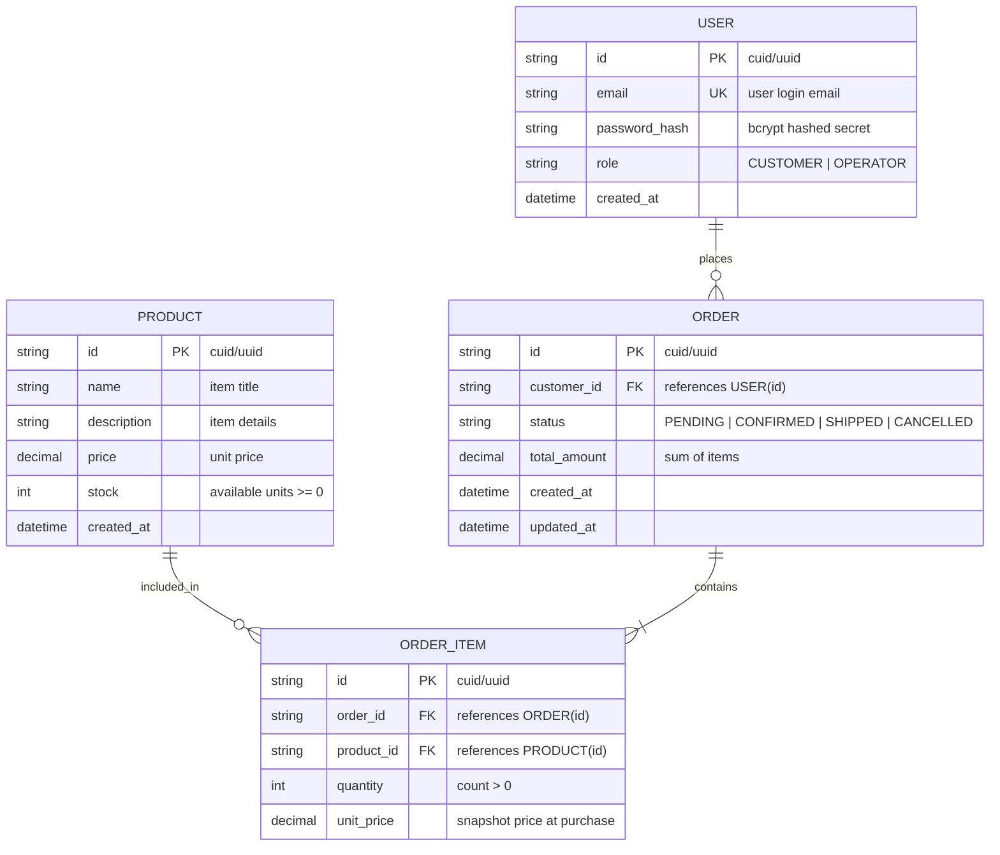

# System-Level Software Design Specification (SDS)

> **Document ID:** SDS-SYS-01  
> **Milestone:** Deliverable 1 (Part C)  
> **Course:** CPE 334 Introduction to Software Engineering in the Age of AI Agents  
> **Theme:** E-Commerce or Ordering System (Customer / Operator)

---

## 1. System Architecture and Component Responsibilities

The system adopts a modular 3-tier client-server architecture designed for reproducible containerization and seamless cloud deployment:



### Component Responsibilities
1. **Frontend (Client):** Built with React and Vite. Renders responsive interfaces for Customer and Operator workflows. Performs client-side form validation, renders loading skeletons, and routes based on authenticated role.
2. **Backend API (Server):** Built with Node.js and Express. Serves as the authoritative business rule enforcer. Authenticates requests, verifies tokens, executes database transactions, and sanitizes input/output.
3. **Database & ORM:** PostgreSQL 16 managed via Prisma ORM. Guarantees relational integrity, foreign key cascading rules, and ACID transactions for inventory deduction.

---

## 2. Data Model and Entity-Relationship Design



### Database Setup, Migrations, and Seed
- **Migration Strategy:** Managed via `prisma migrate dev` (locally) and `prisma migrate deploy` (for production/Cloud Run).
- **Reproducible Seed Data (`prisma/seed.ts`):**
  - Creates 1 Operator account: `operator@store.com`
  - Creates 2 Customer accounts: `alice@customer.com` and `bob@customer.com`
  - Seeds initial catalog products with defined stock (e.g. Mechanical Keyboard: 10 units, Gaming Mouse: 25 units).

---

## 3. UI, API, and Access Conventions

### 3.1 UI Navigation & Shared Behavior
- **Public View:** `/login` and `/register`.
- **Customer View:** `/products` (browsing & checkout button) and `/my-orders` (personal order cards with status badges).
- **Operator View:** `/operator/orders` (management table with action buttons: Confirm, Cancel, Ship).
- **Shared States:** Form input validation errors, network loading indicators, and empty state placeholders ("No orders placed yet").

### 3.2 API Conventions
- **Standard Success Response:**
  ```json
  {
    "success": true,
    "data": { ... }
  }
  ```
- **Standard Error Response:**
  ```json
  {
    "success": false,
    "error": {
      "code": "INSUFFICIENT_STOCK",
      "message": "Requested 5 units but only 2 remain in stock."
    }
  }
  ```

### 3.3 Role & Permission Matrix

| Operation / Path | HTTP Method | Public | Customer | Operator | Failure Status |
|---|:---:|:---:|:---:|:---:|:---:|
| `Register Account` | `POST /api/auth/register` | Allowed | - | - | 400 Bad Request |
| `User Login` | `POST /api/auth/login` | Allowed | Allowed | Allowed | 401 Unauthorized |
| `Current User Profile` | `GET /api/auth/me` | Blocked | Allowed | Allowed | 401 Unauthorized |
| `List Products` | `GET /api/products` | Allowed | Allowed | Allowed | - |
| `Create Order` | `POST /api/orders` | Blocked | Allowed | Blocked | 401 (Public) / 403 (Operator) |
| `Query My Orders` | `GET /api/orders/my-orders` | Blocked | Allowed | Blocked | 401 (Public) / 403 (Operator) |
| `Query Order by ID` | `GET /api/orders/:id` | Blocked | Owner Only | Allowed | 403 Forbidden (Non-owner) |
| `List All Store Orders` | `GET /api/operator/orders` | Blocked | Blocked | Allowed | 403 Forbidden (Customer) |
| `Update Order Status` | `PATCH /api/operator/orders/:id/status` | Blocked | Blocked | Allowed | 403 Forbidden (Customer) |

---

## 4. Authentication, Credentials, and Security Handling

1. **Password Security:** Hashes passwords with `bcrypt` (10 rounds). Plaintext passwords never enter persistence.
2. **Session / Identity:** Issues JWT signed with secret from environment variable (`JWT_SECRET`).
3. **Logout Behavior:** Client clears the stored token; server invalidates the session cookie.
4. **Environment Variables & Secrets:**
   - Documented in `.env.example` with placeholders (`change-me`).
   - Secret keys (`JWT_SECRET`, `DATABASE_URL`) are read exclusively from process environment (`process.env`).

---

## 5. Configuration and GCP Cloud Deployment Design

- **Containerization (Docker):** Application packages into a multi-stage Docker image where Node.js backend serves both API routes and static frontend assets on port `$PORT`.
- **Planned Cloud Stack (Lab 5):**
  - **Runtime:** Google Cloud Run (Serverless container, auto-scaling $0 \leftrightarrow 3$).
  - **Database:** Google Cloud SQL (PostgreSQL 16) with dedicated Unix socket connection.
  - **Secrets:** Google Secret Manager (`DATABASE_URL`, `JWT_SECRET`).
  - **CI/CD:** GitHub Actions with Workload Identity Federation (WIF) enabling keyless authenticated deployment.
